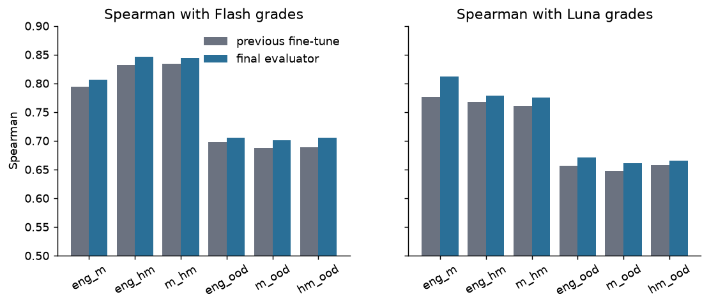
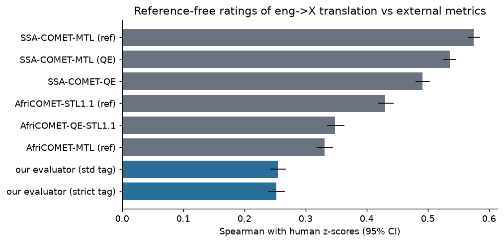
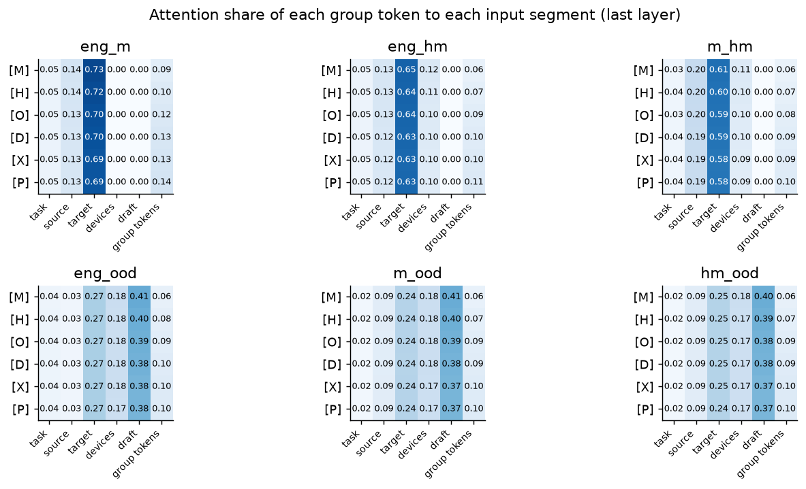
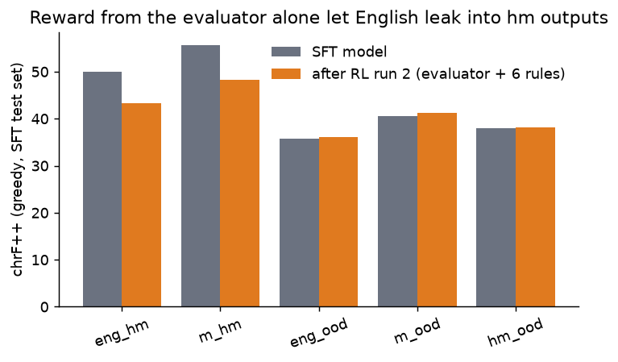
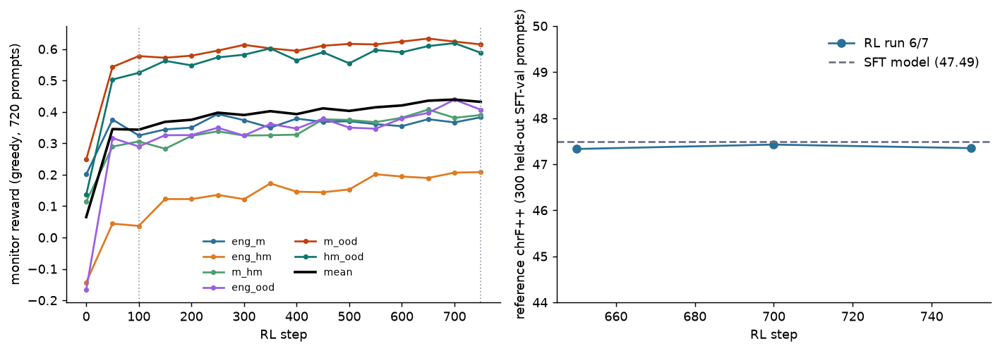

# Reinforcement learning for African-language code-switching and idiom generation: a learned reward alone is not enough

*Working draft, 2026-10-31. Numbers marked **[pending]** are from runs that have not finished. Everything else is taken from logged outputs in `reports/data/`.*

## Abstract

We fine-tune a 301M-parameter decoder (the SFT model) to write human-style code-switched text and idiom-rich text in 37 African languages, and we use reinforcement learning (GRPO) to improve it. The reward is a learned, reference-free evaluator (a fine-tuned mmBERT-base with 27 rating heads) combined with deterministic rule penalties. Our main finding is a negative one about the reward: when the evaluator alone supplied the reward (plus a small set of rules), the proxy reward rose from 0.37 to 0.61 while an independent reference metric fell by about 7 chrF++ on the two code-switching tasks, and English leaked into the output. The failure is invisible to the evaluator, which we show is also a weak judge of translation quality against human ratings (Spearman 0.25 vs 0.49 for SSA-COMET-QE) and blind to hallucinated additions. Adding the missing rules (language-ID guards, function-word and stop-word checks, diacritic, name, number, length, repetition and device-use penalties), a reference-free translation metric, fresh prompts that never occur in the SFT data, and a held-out chrF monitor limits the degradation: after about 750 steps the monitor reward is 0.44 (from 0.07) and average held-out chrF is flat (47.35 vs 47.49), but the average hides a trade-off: the idiom tasks improve (+0.3 to +2.1 chrF++) while the code-switching tasks fall (eng_hm -2.9, m_hm -1.9). We also report a negative interpretability result: the six group tokens we added to the evaluator did not specialise.

## 1. Introduction

Code-switching, mixing a base African language with a second language or with idiom, is the default register of many speakers and is almost absent from public training data. We study how far RL with a learned reward can push a small model in this setting. The question has a safety side: reward-model overoptimisation (Gao et al., 2023) is established for strong English reward models, but low-resource languages are exactly where reward models are weak. We report one controlled-in-spirit case study and the fixes that made RL safe to run.

Contributions: (1) a reference-free evaluator for five code-switching and idiom tasks plus translation, with a full analysis of what it can and cannot judge; (2) a documented reward-hacking episode with an independent metric that exposed it; (3) a rule-anchored reward and monitoring protocol that prevented it; (4) a negative result on per-group special tokens.

## 2. Tasks and data

Six tasks over 37 languages: **eng_m** (English to language, translation replay), **eng_hm** and **m_hm** (English or language text to human-style code-switched text with a declared switch language), **eng_ood**, **m_ood**, **hm_ood** (to idiom-rich text). Each code-switching or idiom output consists of a declared list of devices (the switched phrases or the idioms), followed by the final text, optionally preceded by an English draft. The switch languages per base language come from a ranked table supplied by the author (e.g. Fon: French, Yoruba).

Training data used (all disclosed here and in the model cards): the project's own generated code-switching and idiom corpus (SFT), the evaluator's 167k labelled records (LLM-judge labels, synthetic negatives and corruption chains), and for RL a **fresh prompt pool** (Section 6.1). Not used: SSA-MTE and AfriMTE (CC-BY-SA / CC-BY; benchmark only), NLLB-produced rows, TranslatePsy. The labels come from commercial LLM judges, so the weights are research-only.

## 3. The SFT model and its ablations

The generator is a Gemma-3-270M-based decoder first fine-tuned for English-to-African translation, with language and format tags added to the vocabulary, then fine-tuned on the code-switching and idiom data (832,421 training rows, 17,399 validation, 6,230 curated test rows; the text was generated with a 31B instruction model, filtered by rules and by two LLM judges on about 22% of rows, with judge-corrected copies added). All ablations below used a 20% stratified subsample (166,484 training rows, about 60M tokens), one seed per arm, 2 epochs, an identical recipe (AdamW 5e-5, cosine decay, 262,144-token optimizer steps, loss on completion tokens only), and chrF++ of the final text only (tags, draft and device block removed). The noise floor between two decodes of the same checkpoint is 1-1.6 chrF++, so single-run differences below about 1.5 are not reliable.

| # | Question | Result | Evidence |
|---|---|---|---|
| 1 | Start from the translation-tuned model or from plain Gemma-3-270M? | translation-tuned wins: val loss 1.47 vs 1.91; chrF++ 35.1/38.6 vs 31.1; 20.7% looping outputs vs 0.7-9.3% | established (large gap) |
| 2 | Add 6 interleaved identity-initialised layers (301M) or 12 (335M)? | 6 beats 12: 38.57 vs 37.70, 95% CI of the gap [+0.57, +1.17], better on all 5 tasks | established (same data, recipe, decoder, rows) |
| 3 | Does adding 6 layers beat the 18-layer baseline? | **no** at this data size: baseline 38.72 vs 38.57, CI of the gap [-0.16, +0.45]; an earlier partial comparison (+1.45 for the deeper model) disappeared on the full shared set | refuted by a clean retrain of both arms |
| 4 | Show the generator's English glosses next to each device? | hurts: -1.1 to -2.1 chrF++ on the three idiom tasks, more English leak | established |
| 5 | Give the model an optional English draft? | helps only English-to-idiom (+0.5 greedy / +0.8 sampled, inside the noise floor); hurts m_ood (-2.1) | mixed |

Depth up-scaling arms (identity-initialised copies inserted after every third layer, new layers frozen out for the first 120 steps) and full results per task are in the results package. The deployed generator uses the 24-layer variant, trained on the full data; ablation 3 shows this was not demonstrated to be better than the 18-layer baseline at 20% data. Confounds: one seed per arm; the shared evaluation rows are the shortest prompts of each shard and language-skewed; two decoders (HF generate and vLLM) differ by about 3.5 chrF++ in absolute level, so only within-decoder comparisons are valid; the full-data effect of depth is unknown.

**LLM judges.** We validated candidate judges against human ratings before using them: on 300 SSA-MTE and AfriMTE segments, Gemini 3.8 Flash and 3.1 Pro reach Spearman 0.5-0.6 per language pair with human z-scores, comparable to SSA-COMET-MTL (reference-based), at about $0.001 and $0.005 per segment on the Batch API. Flash graded the training labels; the three judges agree with each other only at 0.6-0.7 on code-switching rows.

## 4. The evaluator

**Architecture.** mmBERT-base with six appended group tokens ([M] translation, [H] code-switching, [O] idiom, [D] devices, [X] extra, [P] overall) each feeding its own two-layer MLP head: 27 outputs on a 1-5 scale. Masked Huber loss; input contains task prefix, source, target, devices and (for half of ood training examples) a draft. One run, optimizer state saved, early stopping with patience 5 (best validation Spearman 0.683 at step 22,500).

**Agreement with LLM judges** (Fig. 1). On the 4,175-row test set, the final evaluator beats the previous fine-tune against Flash on every task (+0.008 to +0.017, 95% CIs above zero) and against luna on every task (hm_ood within noise). On the 299 gold rows Spearman with Argon is 0.69 (hm) and 0.71 (ood). The three judges agree with each other at only about 0.6-0.7, which bounds the evaluator.

*Fig. 1. Spearman agreement of the previous and final evaluator with Flash and luna grades, per task.*

**Structure checks.** On 534 held-out bad-vs-contrast translation pairs the better one scores higher with probability 0.80; ordering accuracy on held-out corruption chains is 84% (translation), 89% (hm), 85% (ood).

**Against humans (negative).** On 20,204 human-rated eng-to-X segments (SSA-MTE test and AfriMTE) the evaluator's pooled Spearman is 0.25 (0.33 within language pair), below SSA-COMET-QE (0.49) and AfriCOMET-QE (0.35) (Fig. 3). It is a usable proxy for the LLM judges, not for humans.

*Fig. 3. Spearman with human ratings on 20,204 eng-to-X segments (95% CI): the evaluator against SSA-COMET and AfriCOMET variants.*

**Internals** (Fig. 2). The six group tokens attend almost identically (shares differ by at most 0.04) and their final hidden states are near-identical (cosine about 1.0 between tokens), so the per-group tokens did not specialise; the heads work through the shared pooled representation. Interventions: scrambling the target lowers every dimension by 1.7-2.4 points; shuffling the source lowers faithfulness-type outputs by 1.6-2.9; removing the devices block changes scores by less than 0.03 (the evaluator does not read devices); showing a draft raises ood scores by 0.07-0.14 (small, so the evaluator is robust to draft on or off).

*Fig. 2. Attention share of each group token to each input segment (last layer), per task.*

## 5. RL method

GRPO with group size 8 (7 sampled at temperature 1 plus the greedy decode), 32 prompts per step (256 sequences, about 35k tokens), AdamW at 2e-6, token-level loss with a k3 KL estimator against the frozen SFT model, an adaptive KL coefficient (target 0.12, hard cut at 0.35), the greedy member's advantage computed against the sampled members' statistics and scaled by 0.3 (cap 3). vLLM samples with weights pushed each step.

**Reward.** `r = max(-1, (S-1)/4 - sum_k w_k p_k)` where S is the evaluator's equal-weight mean over the task's dimensions and `p_k in [0,1]` are rule penalties; a format failure is -1 and skips the evaluator. For eng_m in 14 languages covered by AfriCOMET, `(S-1)/4` is replaced by `0.3 (S-1)/4 + 0.7 q`, with `q` the reference-free AfriCOMET-QE score.

| rule | weight | penalty |
|---|---|---|
| format gate | -1 | missing end token, unclosed draft, no single `<dev>` block with 2+ devices, empty text |
| length | 0.6 | output/source character ratio outside a window (per task; per language for English-source tasks, 5th-95th percentile of the SFT references); draft removed first |
| loop | 1.0 | 2-, 3-, 4-gram distinct shares below 0.80, 0.88, 0.90 (references are above 0.887, 0.96, 0.986) |
| number | 0.8 | changed numeral = 1; missing = 0.6 (0.25 if replaced by an English or language number word, 100 mined) |
| name | 0.4 | names of the English source absent from the output |
| english | 0.8 | English function-word share above 0.20 (ood, eng_m) |
| base_leak | 0.8 | switch-language function words above 12% outside the devices (hm) |
| base_presence | 0.4 | base-language function-word share below 0.6 x the human 5th percentile |
| switch | 1.0 | devices make up 18-45% of the words (hm), linear outside; mostly stop words penalised |
| device_use | 0.6 | listed devices that do not occur in the text |
| diacritic | 0.6 | density below the human 10th percentile, or marks outside the language's human inventory (pooled prior for languages without data) |
| lid | 1.0 | GlotLID sentence labels must be the base or (hm) switch language, weighted by classifier confidence (0 below 0.3, full at 0.8) |
| draft | 0.3 | draft size above 1.5x the source, loops in the draft |

The greedy member's loop, length, lid and base_leak penalties are multiplied by 1.5. A language-ID estimate of the switch share is logged but not rewarded: GlotLID labels the declared devices as the switch language for only 33% of the human references.

**Calibration.** Each rule was run on 6,230 test references and on the SFT model's greedy outputs; rule rates are close for both (so references are not flagged) and far higher for the degraded run-2 outputs (base_leak > 0.15 on 32-36% of hm outputs vs 7-8%).

## 6. Experiments

### 6.1 Prompts and monitors

The first pool took its monolingual and code-switched sources from SFT training rows. The final pool (46,145 train, 720 monitor prompts) has **zero hash overlap** with SFT train, validation and test sources: English-source tasks use fresh English; m_hm and m_ood sources are the SFT model's own greedy translations of other fresh English sentences; hm_ood sources are its own hm outputs; 5,135 of 23,400 generated sources were removed by LID, length, loop, number, English-leak and format filters. The monitor set is fixed. An independent **reference monitor** of 300 SFT-validation prompts (60 per task, never trained on) reports chrF++ of the greedy final text, and a "best" checkpoint is saved only while it stays within 1.0 of the SFT model's 47.49.

### 6.2 Reward hacking with an evaluator-led reward (runs 1-2)

*Fig. 4. chrF++ on the SFT test set before and after the evaluator-led RL run.*

With the evaluator plus six rules (length, loop, number, English, switch share, draft) and no language-ID, function-word or diacritic checks, 540 steps raised the monitor reward from 0.37 to 0.61 (evaluator mean 3.14 to 3.48; format failures 9.6% to 0%). An independent check on the SFT test set told a different story (Fig. 4): chrF++ fell from 50.05 to 43.29 on eng_hm and from 55.58 to 48.35 on m_hm, with English function-word share in hm outputs up from about 0 to 0.08-0.10, while ood tasks were flat or slightly up (36.05 vs 35.69; 41.26 vs 40.49; 38.18 vs 37.96). The proxy improved and the gold-like metric degraded on exactly the tasks where the evaluator cannot see the failure. KL to the SFT model was about 0.15-0.17 throughout.

### 6.3 Rule-anchored RL (runs 6-7)

*Fig. 5. Monitor reward by task (left) and held-out reference chrF++ (right). Dotted lines mark reward changes.*

Training from the SFT model with the full reward and the fresh pool (Fig. 5): monitor reward 0.065 to 0.436 after about 650 steps (m_ood 0.25 to 0.63, hm_ood 0.14 to 0.61, eng_m 0.20 to 0.38, m_hm 0.11 to 0.41, eng_ood -0.17 to 0.40, eng_hm -0.14 to 0.19); format failures 12% to 0.1%; reference chrF++ 47.33 after 650 steps and 47.35 at step 750 against 47.49 for the SFT model. **By task, the average hides a trade-off** (SFT -> step 750, 60 prompts per task, noisy): eng_hm 52.8 -> 49.9, m_hm 59.3 -> 57.4, m_ood 47.6 -> 49.7, eng_ood 35.4 -> 37.0, hm_ood 42.4 -> 42.7; most of the hm decline occurs in the first 650 steps and is flat over the last 100. A milder version of the run-2 pattern: reward up (eng_hm monitor reward 0.015 to 0.21), reference similarity down. The reward definition changed at step 100 (QE weight and per-language length windows) and at step 750 (stronger switch rule, confidence-weighted language ID, eng_hm drawn at 35% of each batch); curves are not comparable across those lines. **[pending]** final 1,500-step results, per-task held-out chrF++ on the SFT test set against the SFT model, and a human-or-judge comparison of the final and SFT outputs.

### 6.4 What the evaluator misses

On 86 logged eng_m samples in AfriCOMET languages the evaluator and AfriCOMET-QE agree with Spearman 0.53; the evaluator scores Nigerian Pidgin about 0.35 higher than QE (0.74 vs 0.39) because it does not penalise appended hallucinated sentences. This motivated the QE term and the per-language length windows. **[pending]** whether the QE term changes eng_m outputs measurably.

## 7. Discussion

*What we claim.* A learned reward from a weak evaluator, plus a handful of rules, can be driven up while an independent reference metric falls, in a low-resource setting, and we found it only because an independent metric existed. Rules that encode what the evaluator cannot see (language identity, function words, repetition, names, devices) reduced it in our setting (run 2: -7 chrF++ on both hm tasks; runs 6-7: -2 to -3, with idiom tasks improving), but did not remove it; the held-out reference monitor should be applied per task, not as an average, which hid the hm decline for 650 steps.

*What we do not claim.* We did not test the hypothesis that overoptimisation sets in earlier or harder than with English reward models: there is no English control, one failure run, endpoint rather than curve measurements of the gold-like metric in run 2, and the independent higher-model gold judge for a proper proxy-versus-gold curve is paused. The monitor and the reward share the evaluator, so monitor gains are not independent evidence of quality; only held-out chrF++ is, and it measures similarity to SFT-style references, which RL is not trying to maximise.

## 8. Limitations and ethics

Small model; one seed per configuration; LLM-judge labels (no human ratings of code-switching quality); the switch-share rule penalises 29-36% of human references; GlotLID is unreliable on short mixed spans; number-word and diacritic tables are incomplete (8 languages have no diacritic block, number words exist for about 30 languages and are sparse); the switch-language table is a human-supplied list that includes pairs a native speaker may find unnatural. Generated text may be wrong or offensive in languages we cannot fully review.

## 9. Availability

Weights and data are available to reviewers on request. This document and the accompanying results package (tables, figures, logs and model cards) contain everything needed to evaluate the claims made here.
