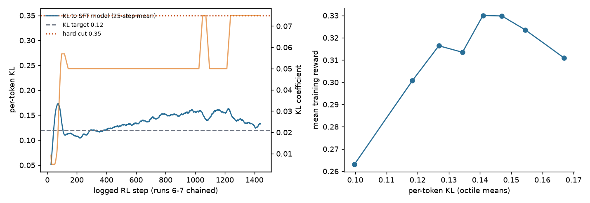
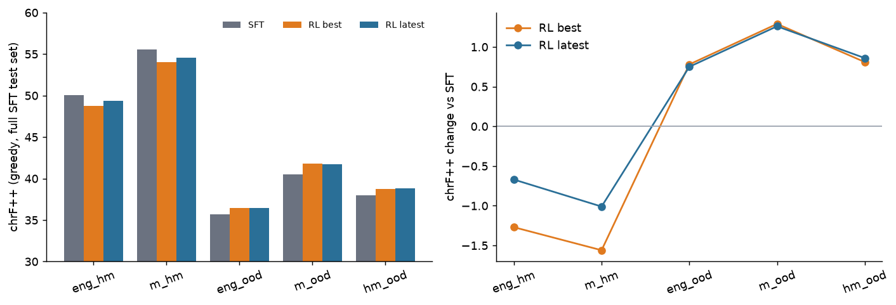
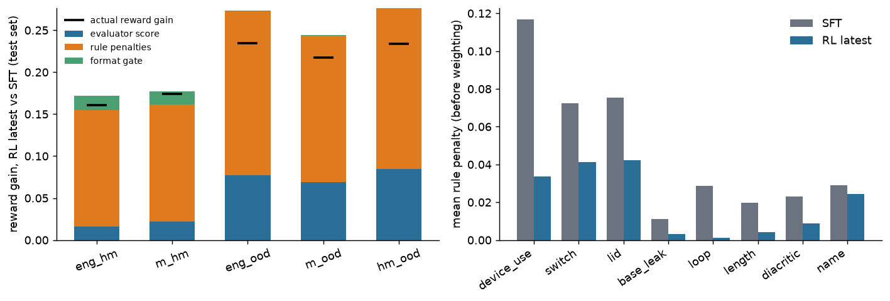
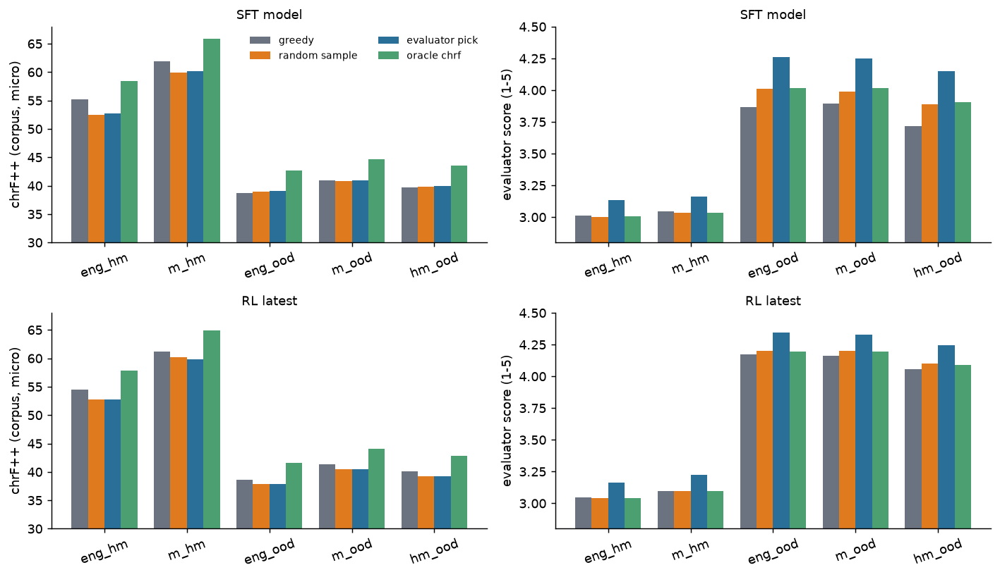
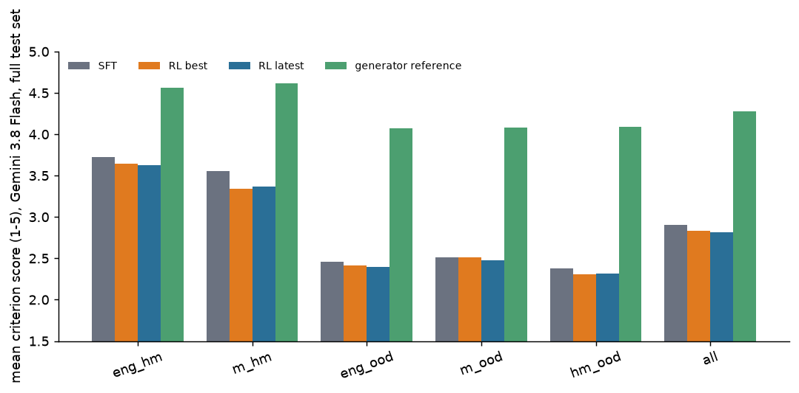
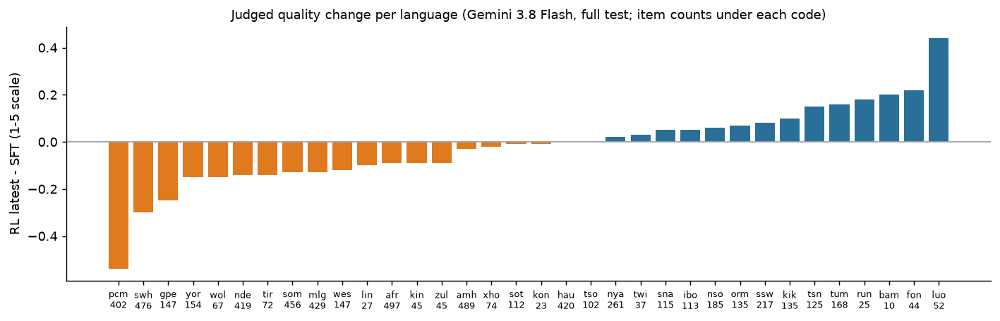

# Reinforcement learning for African-language code-switching and idiom generation: a learned reward alone is not enough

*Working draft, 2026-10-31. Numbers marked **[pending]** are from runs that have not finished. Everything else is taken from logged outputs in `reports/data/`.*

## Abstract

We fine-tune a 301M-parameter decoder (the SFT model) to write human-style code-switched text and idiom-rich text in 37 African languages, and we use reinforcement learning (GRPO) to improve it. The reward is a learned, reference-free evaluator (a fine-tuned mmBERT-base with 27 rating heads) combined with deterministic rule penalties. Our main finding is a negative one about the reward: when the evaluator alone supplied the reward (plus a small set of rules), the proxy reward rose from 0.37 to 0.61 while an independent reference metric fell by about 7 chrF++ on the two code-switching tasks, and English leaked into the output. The failure is invisible to the evaluator, which we show is also a weak judge of translation quality against human ratings (Spearman 0.25 vs 0.49 for SSA-COMET-QE) and blind to hallucinated additions. Adding the missing rules (language-ID guards, function-word and stop-word checks, diacritic, name, number, length, repetition and device-use penalties), a reference-free translation metric, fresh prompts that never occur in the SFT data, and a held-out chrF monitor limits the degradation. On the full SFT test set (6,230 items, 34 languages, greedy decoding) the final policy changes chrF++ by +0.8 to +1.3 on the three idiom tasks and by -0.7 and -1.0 on the two code-switching tasks; format validity rises from about 95% to 99.8%; and the mean reward rises from 0.14-0.53 to 0.28-0.74. Only about a quarter of that reward gain comes from the learned evaluator; about three quarters comes from the rules. An independent comparison with LLM judges (Gemini 3.8 Flash on the full test set, 24,898 graded outputs of four systems with a standard system-blind rubric; a Gemini 4 Argon cross-check on 1,000 items) finds the RL policy judged slightly worse than the SFT model (-0.09 on a 1-5 scale, 95% CI [-0.10, -0.07]; every task significantly lower, most on monolingual-to-code-switch at -0.19 and for Nigerian Pidgin at -0.54) and 1.4 points below the text of the data-generation model: the reward gains do not translate into judged quality. We also report a negative interpretability result: the six group tokens added to the evaluator did not specialise. Finally we describe, but have not yet run, a human preference study: an 8,300-item pool with 29,938 pairs, frozen automatic scores and a pre-set reporting rule, built to measure how far automatic signals (our evaluator, an LLM judge, chrF++, the rule score) agree with human choices, and so how much of this task can be judged without humans.

## 1. Introduction

Code-switching, mixing a base African language with a second language or with idiom, is the default register of many speakers and is almost absent from public training data. We study how far RL with a learned reward can push a small model in this setting. The question has a safety side: reward-model overoptimisation (Gao et al., 2023) is established for strong English reward models, but low-resource languages are exactly where reward models are weak. We report one controlled-in-spirit case study and the fixes that made RL safe to run.

Contributions: (1) a reference-free evaluator for five code-switching and idiom tasks plus translation, with a full analysis of what it can and cannot judge; (2) a documented reward-hacking episode with an independent metric that exposed it; (3) a rule-anchored reward and monitoring protocol that prevented it; (4) a negative result on per-group special tokens; (5) the design of a human preference study (section 7b) whose questions follow from the above.

Research questions for the human study. Humans are the gold standard for code-switching quality, and our automatic signals disagree with each other and with independent judges. We therefore ask: (Q1) how well does each automatic signal (the evaluator, Gemini Flash, chrF++ against references, the rule score) predict which of two candidates native speakers prefer, and how does that vary by language and task; (Q2) what is the floor, that is, how much can be done with no human input at all, and where does it stop; (Q3) how reliable is LLM-as-judge across these languages, measured as agreement with the human majority, with the human inter-annotator agreement as the ceiling; (Q4) is the RL policy's judged decline (section 6.5c) also seen by humans. None of these is answered in this paper; section 7b states the protocol so that it is fixed before any vote is collected.

## 2. Tasks and data

Six tasks over 37 languages: **eng_m** (English to language, translation replay), **eng_hm** and **m_hm** (English or language text to human-style code-switched text with a declared switch language), **eng_ood**, **m_ood**, **hm_ood** (to idiom-rich text). Each code-switching or idiom output consists of a declared list of devices (the switched phrases or the idioms), followed by the final text, optionally preceded by an English draft. The switch languages per base language come from a ranked table supplied by the author (e.g. Fon: French, Yoruba).

Training data used (all disclosed here and in the model cards): the project's own generated code-switching and idiom corpus (SFT), the evaluator's 167k labelled records (LLM-judge labels, synthetic negatives and corruption chains), and for RL a **fresh prompt pool** (Section 6.1). Not used: SSA-MTE and AfriMTE (CC-BY-SA / CC-BY; benchmark only), NLLB-produced rows, TranslatePsy. The labels come from commercial LLM judges, so the weights are research-only.

## 3. The SFT model and its ablations

The generator is a Gemma-3-270M-based decoder first fine-tuned for English-to-African translation, with language and format tags added to the vocabulary, then fine-tuned on the code-switching and idiom data (832,421 training rows, 17,399 validation, 6,230 curated test rows; the text was generated with a 31B instruction model, filtered by rules and by two LLM judges on about 22% of rows, with judge-corrected copies added). All ablations below used a 20% stratified subsample (166,484 training rows, about 60M tokens), one seed per arm, 2 epochs, an identical recipe (AdamW 5e-5, cosine decay, 262,144-token optimizer steps, loss on completion tokens only), and chrF++ of the final text only (tags, draft and device block removed). The noise floor between two decodes of the same checkpoint is 1-1.6 chrF++, so single-run differences below about 1.5 are not reliable.

| # | Question | Result | Evidence |
|---|---|---|---|
| 1 | Start from the translation-tuned model or from plain Gemma-3-270M? | translation-tuned wins: val loss 1.47 vs 1.91; chrF++ 35.1/38.6 vs 31.1; 20.7% looping outputs vs 0.7-9.3% | established (large gap) |
| 2 | Add 6 interleaved identity-initialised layers (301M) or 12 (335M)? | 6 beats 12: 38.57 vs 37.70, 95% CI of the gap [+0.57, +1.17], better on all 5 tasks | established (same data, recipe, decoder, rows) |
| 3 | Does adding 6 layers beat the 18-layer baseline? | **no** at this data size: baseline 38.72 vs 38.57, CI of the gap [-0.16, +0.45]; an earlier partial comparison (+1.45 for the deeper model) disappeared on the full shared set | refuted by a clean retrain of both arms |
| 4 | Show the generator's English glosses next to each device? | hurts: -1.1 to -2.1 chrF++ on the three idiom tasks, more English leak | established |
| 5 | Give the model an optional English draft? | helps only English-to-idiom (+0.5 greedy / +0.8 sampled, inside the noise floor); hurts m_ood (-2.1) | mixed |

Depth up-scaling arms (identity-initialised copies inserted after every third layer, new layers frozen out for the first 120 steps) and full results per task are in the results package. The deployed generator uses the 24-layer variant, trained on the full data; ablation 3 shows this was not demonstrated to be better than the 18-layer baseline at 20% data. Confounds: one seed per arm; the shared evaluation rows are the shortest prompts of each shard and language-skewed; two decoders (HF generate and vLLM) differ by about 3.5 chrF++ in absolute level, so only within-decoder comparisons are valid; the full-data effect of depth is unknown.

**LLM judges.** We validated candidate judges against human ratings before using them: on 300 SSA-MTE and AfriMTE segments, Gemini 3.8 Flash and 3.1 Pro reach Spearman 0.5-0.6 per language pair with human z-scores, comparable to SSA-COMET-MTL (reference-based), at about $0.001 and $0.005 per segment on the Batch API. Flash graded the training labels; the three judges agree with each other only at 0.6-0.7 on code-switching rows.

## 4. The evaluator

**Architecture.** mmBERT-base with six appended group tokens ([M] translation, [H] code-switching, [O] idiom, [D] devices, [X] extra, [P] overall) each feeding its own two-layer MLP head: 27 outputs on a 1-5 scale. Masked Huber loss; input contains task prefix, source, target, devices and (for half of ood training examples) a draft. One run, optimizer state saved, early stopping with patience 5 (best validation Spearman 0.683 at step 22,500).

**Agreement with LLM judges** (Fig. 1). On the 4,175-row test set, the final evaluator beats the previous fine-tune against Flash on every task (+0.008 to +0.017, 95% CIs above zero) and against luna on every task (hm_ood within noise). On the 299 gold rows Spearman with Argon is 0.69 (hm) and 0.71 (ood). The three judges agree with each other at only about 0.6-0.7, which bounds the evaluator.

*Fig. 1. Spearman agreement of the previous and final evaluator with Flash and luna grades, per task.*

**Structure checks.** On 534 held-out bad-vs-contrast translation pairs the better one scores higher with probability 0.80; ordering accuracy on held-out corruption chains is 84% (translation), 89% (hm), 85% (ood).

**Against humans (negative).** On 20,204 human-rated eng-to-X segments (SSA-MTE test and AfriMTE) the evaluator's pooled Spearman is 0.25 (0.33 within language pair), below SSA-COMET-QE (0.49) and AfriCOMET-QE (0.35) (Fig. 3). It is a usable proxy for the LLM judges, not for humans.

*Fig. 3. Spearman with human ratings on 20,204 eng-to-X segments (95% CI): the evaluator against SSA-COMET and AfriCOMET variants.*

**Internals** (Fig. 2). The six group tokens attend almost identically (shares differ by at most 0.04) and their final hidden states are near-identical (cosine about 1.0 between tokens), so the per-group tokens did not specialise; the heads work through the shared pooled representation. Interventions: scrambling the target lowers every dimension by 1.7-2.4 points; shuffling the source lowers faithfulness-type outputs by 1.6-2.9; removing the devices block changes scores by less than 0.03 (the evaluator does not read devices); showing a draft raises ood scores by 0.07-0.14 (small, so the evaluator is robust to draft on or off).

*Fig. 2. Attention share of each group token to each input segment (last layer), per task.*

## 5. RL method

GRPO with group size 8 (7 sampled at temperature 1 plus the greedy decode), 32 prompts per step (256 sequences, about 35k tokens), AdamW at 2e-6, token-level loss with a k3 KL estimator against the frozen SFT model, an adaptive KL coefficient (target 0.12, hard cut at 0.35), the greedy member's advantage computed against the sampled members' statistics and scaled by 0.3 (cap 3). vLLM samples with weights pushed each step.

**Reward.** `r = max(-1, (S-1)/4 - sum_k w_k p_k)` where S is the evaluator's equal-weight mean over the task's dimensions and `p_k in [0,1]` are rule penalties; a format failure is -1 and skips the evaluator. For eng_m in 14 languages covered by AfriCOMET, `(S-1)/4` is replaced by `0.3 (S-1)/4 + 0.7 q`, with `q` the reference-free AfriCOMET-QE score.

| rule | weight | penalty |
|---|---|---|
| format gate | -1 | missing end token, unclosed draft, no single `<dev>` block with 2+ devices, empty text |
| length | 0.6 | output/source character ratio outside a window (per task; per language for English-source tasks, 5th-95th percentile of the SFT references); draft removed first |
| loop | 1.0 | 2-, 3-, 4-gram distinct shares below 0.80, 0.88, 0.90 (references are above 0.887, 0.96, 0.986) |
| number | 0.8 | changed numeral = 1; missing = 0.6 (0.25 if replaced by an English or language number word, 100 mined) |
| name | 0.4 | names of the English source absent from the output |
| english | 0.8 | English function-word share above 0.20 (ood, eng_m) |
| base_leak | 0.8 | switch-language function words above 12% outside the devices (hm) |
| base_presence | 0.4 | base-language function-word share below 0.6 x the human 5th percentile |
| switch | 1.0 | devices make up 18-45% of the words (hm), linear outside; mostly stop words penalised |
| device_use | 0.6 | listed devices that do not occur in the text |
| diacritic | 0.6 | density below the human 10th percentile, or marks outside the language's human inventory (pooled prior for languages without data) |
| lid | 1.0 | GlotLID sentence labels must be the base or (hm) switch language, weighted by classifier confidence (0 below 0.3, full at 0.8) |
| draft | 0.3 | draft size above 1.5x the source, loops in the draft |

The greedy member's loop, length, lid and base_leak penalties are multiplied by 1.5. A language-ID estimate of the switch share is logged but not rewarded: GlotLID labels the declared devices as the switch language for only 33% of the human references.

**Calibration.** Each rule was run on 6,230 test references and on the SFT model's greedy outputs; rule rates are close for both (so references are not flagged) and far higher for the degraded run-2 outputs (base_leak > 0.15 on 32-36% of hm outputs vs 7-8%).

## 6. Experiments

### 6.1 Prompts and monitors

The first pool took its monolingual and code-switched sources from SFT training rows. The final pool (46,145 train, 720 monitor prompts) has **zero hash overlap** with SFT train, validation and test sources: English-source tasks use fresh English; m_hm and m_ood sources are the SFT model's own greedy translations of other fresh English sentences; hm_ood sources are its own hm outputs; 5,135 of 23,400 generated sources were removed by LID, length, loop, number, English-leak and format filters. The monitor set is fixed. An independent **reference monitor** of 300 SFT-validation prompts (60 per task, never trained on) reports chrF++ of the greedy final text, and a "best" checkpoint is saved only while it stays within 1.0 of the SFT model's 47.49.

### 6.2 Reward hacking with an evaluator-led reward (runs 1-2)

*Fig. 4. chrF++ on the SFT test set before and after the evaluator-led RL run.*

With the evaluator plus six rules (length, loop, number, English, switch share, draft) and no language-ID, function-word or diacritic checks, 540 steps raised the monitor reward from 0.37 to 0.61 (evaluator mean 3.14 to 3.48; format failures 9.6% to 0%). An independent check on the SFT test set told a different story (Fig. 4): chrF++ fell from 50.05 to 43.29 on eng_hm and from 55.58 to 48.35 on m_hm, with English function-word share in hm outputs up from about 0 to 0.08-0.10, while ood tasks were flat or slightly up (36.05 vs 35.69; 41.26 vs 40.49; 38.18 vs 37.96). The proxy improved and the gold-like metric degraded on exactly the tasks where the evaluator cannot see the failure. KL to the SFT model was about 0.15-0.17 throughout.

### 6.3 Rule-anchored RL (runs 6-7)

*Fig. 5. Monitor reward by task (left) and held-out reference chrF++ (right). Dotted lines mark reward changes.*

Training from the SFT model with the full reward and the fresh pool (about 1,500 logged steps over several resumed segments; the reward definition changed at step 100 and at step 750, so curves are not comparable across the dotted lines): the greedy monitor reward rose from 0.065 to about 0.43 and then plateaued (0.40-0.44 over the last 350 steps); format failures fell from 12% to 0.1%. KL to the SFT model stayed between 0.10 and 0.20 per token (Fig. 6) and the hard cut at 0.35 was never triggered. The 300-prompt held-out chrF monitor is noisy (about +-1-1.5 chrF++ per task at 60 prompts per task), so checkpoints are compared on the full test set.

*Fig. 6. Per-token KL to the SFT model and the adaptive KL coefficient across the chained runs (left); mean training reward by KL octile (right; confounded with training phase).*

**Full SFT test set** (6,230 items, 34 languages; greedy decoding; chrF++ of the final text, macro over languages; the same vLLM decoder for all systems). "Best" is the highest-reward checkpoint that passed the per-task chrF guard; "latest" is the final policy.

| task | SFT | RL best | RL latest | latest - SFT |
|---|---|---|---|---|
| eng_hm | 50.05 | 48.78 | 49.38 | -0.67 |
| m_hm | 55.58 | 54.02 | 54.57 | -1.01 |
| eng_ood | 35.69 | 36.47 | 36.44 | +0.75 |
| m_ood | 40.49 | 41.78 | 41.75 | +1.26 |
| hm_ood | 37.96 | 38.77 | 38.82 | +0.86 |

Format validity (one device block, two or more devices, non-empty text) rises from 0.949 and 0.954 (eng_hm, m_hm) to 0.996 and 0.999, and is 1.000 on the idiom tasks; the English-function-word excess in code-switching outputs stays at about zero (-0.011 and -0.003 against -0.003 and +0.003 for the SFT model), unlike run 2 (+0.08 and +0.105). The latest checkpoint is at least as good as "best" on every task (the guard, built on 60-prompt monitors, selected on noise).

*Fig. 7. chrF++ on the full SFT test set (left) and the change relative to the SFT model (right).*

### 6.5 Where the reward gain comes from

We scored the same 6,230 test outputs of each system with the final evaluator and, with no weights applied, each rule (greedy decoding; no API calls).

| task | evaluator (1-5): SFT -> RL latest | reward: SFT -> RL latest | format failures: SFT -> RL latest |
|---|---|---|---|
| eng_hm | 3.013 -> 3.044 | 0.122 -> 0.283 | 2.0% -> 0.3% |
| m_hm | 3.044 -> 3.099 | 0.141 -> 0.315 | 1.7% -> 0.1% |
| eng_ood | 3.867 -> 4.173 | 0.473 -> 0.708 | 0.1% -> 0.0% |
| m_ood | 3.891 -> 4.165 | 0.525 -> 0.742 | 0.1% -> 0.0% |
| hm_ood | 3.715 -> 4.054 | 0.470 -> 0.704 | 0.0% -> 0.0% |

Splitting the mean reward gain (+0.204 for latest, +0.210 for best; components sum to about 0.228 before clamping) gives: **evaluator score +0.054 (about 24-26%)**, **rule penalties +0.168 (about 74%)** and format gate +0.007 (about 3%). By task the evaluator accounts for 10-13% of the gain on the code-switching tasks and 32-36% on the idiom tasks. Most of the rule gain is device use (0.12 to 0.03 mean penalty), switch share (0.07 to 0.04), language ID (0.08 to 0.04), repetition (0.03 to 0.00), length and diacritics (Fig. 8). The model therefore did **not** improve "solely from the evaluator's feedback": the evaluator moved by +0.05 points on the 1-5 scale for code-switching and +0.3 for idioms, while most of the reward came from rules that the evaluator itself does not check. Whether the outputs are better in ways that matter is the question of the independent comparisons below.

*Fig. 8. Decomposition of the reward gain (left; the black bar is the actual gain, components are approximate because of clamping) and mean rule penalties before and after RL (right).*

### 6.5b Decoding: greedy, sampling and best-of-8 with the evaluator as selector

For each test prompt we also drew eight samples (temperature 0.7, top-p 0.95) from the SFT model and from the latest RL policy, scored all nine candidates (greedy plus eight samples) with the final evaluator, and took the highest-scoring valid candidate (format failures rank last). No API calls were used. Corpus chrF++ is micro-averaged per task here, so absolute values are higher than the macro-over-languages numbers above; compare rows within the table.

| system | task | greedy | random sample | evaluator pick | oracle (best chrF of 9) |
|---|---|---|---|---|---|
| SFT | eng_hm | 55.14 | 52.47 | 52.78 | 58.49 |
| SFT | m_hm | 61.93 | 59.97 | 60.17 | 65.82 |
| SFT | eng_ood | 38.70 | 38.91 | 39.07 | 42.74 |
| SFT | m_ood | 40.89 | 40.77 | 40.94 | 44.67 |
| SFT | hm_ood | 39.65 | 39.89 | 39.97 | 43.59 |
| RL latest | eng_hm | 54.54 | 52.77 | 52.80 | 57.82 |
| RL latest | m_hm | 61.21 | 60.17 | 59.78 | 64.89 |
| RL latest | eng_ood | 38.60 | 37.89 | 37.82 | 41.57 |
| RL latest | m_ood | 41.37 | 40.48 | 40.48 | 44.09 |
| RL latest | hm_ood | 40.11 | 39.30 | 39.28 | 42.81 |

The best RL checkpoint behaves the same as the latest one (greedy / evaluator pick chrF++: eng_hm 54.39 / 52.64, m_hm 61.06 / 60.02, eng_ood 38.72 / 37.83, m_ood 41.49 / 40.37, hm_ood 40.11 / 39.23; table in the results package).

Findings: (i) sampling does not improve the per-sample chrF++: it lowers it on the code-switching tasks (by 2-3 points) and leaves it unchanged for the SFT model on the idiom tasks, and lowers it by about 0.8 for the RL policy, which was trained against greedy-heavy penalties; (ii) the evaluator as a selector raises the evaluator score of the pick (for example SFT eng_hm 3.01 to 3.13, eng_ood 3.87 to 4.26) and cuts format failures (SFT eng_hm 2.0% to 0.3%) but does not raise chrF++ above the greedy output, and for the RL policy it is slightly below greedy; (iii) there is substantial headroom (the oracle pick is 3-4 chrF++ above greedy), so a better selector, not more sampling, is what would help; the evaluator is not that selector. For human preference collection, sampled candidates add diversity without a systematic quality gain per sample, and the greedy output remains the strongest single candidate by this measure.

*Fig. 9. Greedy, random sample, evaluator pick and oracle pick: chrF++ (left) and evaluator score (right) for the SFT model (top) and the latest RL policy (bottom).*

### 6.5c Independent comparison with LLM judges

To test whether the reward gains correspond to judged quality, we graded the outputs of four systems on the full SFT test set with Gemini 3.8 Flash on the Batch API: the SFT model, the best and the latest RL checkpoint (greedy outputs), and the data-generation model's own curated text for the same items (the test references): 6,225 distinct items, 24,900 requests, 24,898 graded (actual cost $13.52). The prompt is a standard, system-blind rubric (Appendix A): six criteria per task, integer anchors, no rule measurements, no forced grade distribution, requests of all systems shuffled together. Flash is also the judge that produced the evaluator's training labels, so this is not fully independent of the evaluator. As a cross-check we graded a stratified 1,000-item subset (200 per task) with a second judge, Gemini 4 Argon, with the same prompt (cost $6.36).

| task | SFT | RL best | RL latest | generator | RL latest - SFT (95% CI over items) |
|---|---|---|---|---|---|
| eng_hm | 3.722 | 3.644 | 3.629 | 4.562 | -0.093 [-0.127, -0.057] |
| m_hm | 3.552 | 3.343 | 3.364 | 4.615 | -0.188 [-0.227, -0.148] |
| eng_ood | 2.457 | 2.417 | 2.394 | 4.072 | -0.063 [-0.094, -0.033] |
| m_ood | 2.514 | 2.509 | 2.472 | 4.080 | -0.042 [-0.075, -0.008] |
| hm_ood | 2.378 | 2.311 | 2.314 | 4.094 | -0.064 [-0.097, -0.029] |
| **all** | **2.906** | **2.829** | **2.818** | **4.275** | **-0.088 [-0.104, -0.072]** |

*Fig. 10. Mean criterion score per system and task from Gemini 3.8 Flash with the standard prompt, full test set.*

**The RL policy is judged slightly worse than the SFT model, on every task.** The decline is small (-0.09 on a 1-5 scale) but significant for every task, largest on monolingual-to-code-switch (-0.19), and the best checkpoint is no better than the latest. By criterion the code-switching outputs lose on meaning (3.41 to 3.24), switching naturalness (3.09 to 2.85) and overall (2.93 to 2.75) and are unchanged on language compliance (4.83 to 4.80); the idiom outputs are unchanged on meaning (1.97 to 1.96) and language correctness (2.51 to 2.47) and lose on idiom use (1.73 to 1.54) and naturalness (1.92 to 1.81), while language compliance rises (4.73 to 4.83), which is a rule target. Head to head on the overall criterion, the latest policy beats SFT on 17-21% of items and loses on 24-36%. Both models are far below the generator's own text (+1.37 on average, 0.84-1.72 per task), which is the real quality gap. A stratified 1,000-item sample of the same comparison found no significant overall change (-0.015, CI [-0.055, +0.025]), and the Argon cross-check on the same 1,000 items likewise (-0.005, CI [-0.036, +0.024], with a significant -0.14 on m_hm and a generator gap of +0.84): those samples were too small to detect an effect of this size, which the full test set shows. The two judges agree at Spearman 0.82 on the overall criterion (identical grade for 55% of requests, within one point for 95%); Argon is the stricter judge (mean overall criterion on the idiom tasks 1.3-1.4 against 1.7-1.9).

**Per language** (Fig. 11), the change ranges from -0.54 (Nigerian Pidgin, 402 items) through -0.30 (Swahili) and -0.25 (Ghanaian Pidgin) to +0.44 (Luo, 52 items), with the small languages (under 70 items) too noisy to interpret; 18 of 34 languages decline and two are unchanged (hau, tso), including most of the large ones.

*Fig. 11. Change in judged quality (RL latest - SFT, Flash, full test) per language; item counts under each language code.*

**Prompt sensitivity.** We re-graded a 300-item subset with the old strict prompt used to produce the evaluator's labels (the same Flash model, 1,198 graded pairs, cost $0.40). The two prompts agree at Spearman 0.84 across (item, system) pairs and rank the generator far above the models in both. The old prompt, which shows the judge our rule measurements, scores the RL outputs higher than SFT on the idiom tasks (+0.2 to +0.3 on the dimension mean) and eng_hm (+0.1), where the standard prompt sees no gain: part of what the training labels, and therefore the evaluator and the reward, reward is the rule signal itself.

### 6.6 What the evaluator misses

On 86 logged eng_m samples in AfriCOMET languages the evaluator and AfriCOMET-QE agree with Spearman 0.53; the evaluator scores Nigerian Pidgin about 0.35 higher than QE (0.74 vs 0.39) because it does not penalise appended hallucinated sentences. This motivated the QE term and the per-language length windows. We did not run a separate test of how much the QE term alone changes eng_m outputs.

### 6.6b Does the evaluator rank outputs of the same prompt?

The evaluator agrees well with Flash on its own held-out labels (Spearman 0.69 to 0.85 depending on the task), so we expected it to carry more signal than it did. GRPO, however, only uses differences between the outputs of one prompt, and an overall correlation says little about that. We compared the evaluator score with the Flash overall grade on the three systems' greedy outputs for the same prompt (18,629 outputs, 6,222 prompts; `results/evaluator/within_prompt.md`).

| view | evaluator vs Flash |
|---|---|
| pooled over all outputs (Spearman) | -0.19 |
| pooled inside one task (Spearman) | 0.00 (eng_hm) to 0.36 (eng_ood) |
| inside one prompt, three systems (Pearson) | +0.11 (reward: +0.00) |
| pairwise, when Flash prefers A over B | the evaluator picks the same one 54% of the time |
| RL best, nine candidates per prompt, vs chrF++ (Pearson) | +0.27 |

The pooled value is negative because the two scales sit at different levels for different tasks (the evaluator gives the idiom tasks about 4.0 and Flash about 1.8). Inside a prompt the evaluator is close to uninformative. Fitting evaluator to Flash on the SFT outputs gives a slope of 0.03: one evaluator point is worth three hundredths of a Flash point. RL raised the evaluator score by about 0.2, which that fit translates to about +0.02 in Flash, but the Flash overall criterion fell by 0.12 to 0.13 (actual minus predicted: -0.13 for RL best, -0.15 for RL latest). A constant correction of the evaluator's offset would not have changed training, because GRPO subtracts the group mean, and adding noise could not have helped. The remedy that follows from these numbers is to lower the evaluator's weight in proportion to its reliability, which here is close to zero. We did not run that experiment, so we cannot say how much the rules alone would have changed the judged result. The three systems share a prompt and are often nearly the same text (Flash gives the same grade to more than half of the pairs), and the nine sampled candidates were never graded by Flash (chrF++ is a rough stand-in), so the within-prompt numbers are indicative, not definitive.

## 7. Discussion

*What we claim.* RL with this reward improved what the reward measures (format validity, repetition, device use, language identity, evaluator score) but slightly lowered quality as judged by an independent rubric (-0.09 on a 1-5 scale on the full test set, every task lower). A learned reward from a weak evaluator, plus a handful of rules, can be driven up while an independent reference metric falls, in a low-resource setting, and we found it only because an independent metric existed. Rules that encode what the evaluator cannot see (language identity, function words, repetition, names, devices) reduced it in our setting (run 2: -7 chrF++ on both hm tasks; runs 6-7 on the full test set: -0.7 and -1.0, with the idiom tasks improving by 0.8-1.3), but did not remove it. Most of the reward gain came from the rules, not from the evaluator, which ranks the outputs of one prompt only slightly better than chance against Flash (section 6.6b); and the held-out reference monitor should be applied per task, not as an average, which hid the code-switching decline.

*What we do not claim.* We did not test the hypothesis that overoptimisation sets in earlier or harder than with English reward models: there is no English control, one failure run, endpoint rather than curve measurements of the gold-like metric in run 2, and the independent higher-model gold judge for a proper proxy-versus-gold curve is paused. The monitor and the reward share the evaluator, so monitor gains are not independent evidence of quality; only held-out chrF++ is, and it measures similarity to SFT-style references, which RL is not trying to maximise.

## 7b. Human preference study design (not yet run)

*Pool.* 8,300 items over 37 base languages and five code-switching and idiom tasks plus English-to-language translation, each with one greedy output and 6-8 sampled variants from the RL policy (final checkpoint), plus the SFT model's output where the item comes from the curated test set. Selection order: (i) every curated test item first (6,225 items, 34 languages, with reference, SFT and RL outputs, Flash grades already available); (ii) additional items from a 20k generation pool, deduplicated to one row per task and normalised English source, excluding any English source in the test prompts, added by water-filling over languages up to a common level (142 items per language), then stratified over tasks; (iii) 300 extra items chosen to widen the evaluator-score range in languages where it was narrow (Nigerian Pidgin, Guadeloupean Creole and Wes-Cameroon Pidgin had within-language standard deviations of 0.20-0.26). Candidates in the pool are scored with the final evaluator before any human vote, and those scores are frozen. English-to-language translation sources use the translation-tuned model (rl2c). Language coverage is uneven by design (large languages up to 400-500 items, floor 142-144); Ewe, Fulfulde and Luganda have no curated test items.

*Pairs.* 29,938 pairs of four kinds: greedy against sampled, the widest evaluator gap within an item, adjacent evaluator ranks, and reference against RL output. Pairs are not limited to the top-scored candidates, so that the study can see where the evaluator is wrong at the bottom and middle as well. Left/right order is a seeded bit that the site must re-randomise. 260 attention checks pair a candidate with a word-shuffled copy of itself; a rater who prefers the shuffled copy is excluded.

*Rater information.* Per rater: languages spoken (mother tongue or fluent), whether they write the language, whether they code-switch themselves, age band and country. No free text is stored.

*Reporting rule.* Headline: pairwise agreement of each signal with the human majority choice, and the win-rate of each judge against it, with the human inter-annotator agreement per language as the ceiling. A language is reported alone only with at least 300 pair judgments from at least 3 raters and at least 100 pairs judged by at least 2 raters; others are pooled and flagged. Automatic scores are frozen before collection; we will not refit a judge to the votes and report agreement on the same votes.

*Framing.* The study measures how far automatic signals alone get, measured against humans. It is not a claim that the human labels are cheap or that the pool is a benchmark of model quality.

## 8. Limitations and ethics

Small model; one seed per configuration; LLM-judge labels (no human ratings of code-switching quality), produced with a prompt that also showed the judge our own rule measurements (switch share, English-word share) and demanded that about half of all grades be 3 or lower, so the labels partly encode our rules and the evaluator cannot be read as an objective quality measure; cost limited thorough testing with several judges: the full-test comparison uses one judge (Gemini 3.8 Flash), which also produced the evaluator's training labels and is therefore not fully independent of it, and the second judge (Argon) was run on a 1,000-item subset only; no human evaluation of code-switching quality yet (a blind candidate pool of 8,300 items for a human preference study is built and its protocol is fixed in section 7b, but no votes have been collected; the pool is uneven across languages by design, and Ewe, Fulfulde and Luganda have no curated test items); the switch-share rule penalises 29-36% of human references; GlotLID is unreliable on short mixed spans; number-word and diacritic tables are incomplete (8 languages have no diacritic block, number words exist for about 30 languages and are sparse); the switch-language table is a human-supplied list that includes pairs a native speaker may find unnatural. Generated text may be wrong or offensive in languages we cannot fully review.

## 9. Availability

Weights and data are available to reviewers on request. This document and the accompanying results package (tables, figures, logs and model cards) contain everything needed to evaluate the claims made here.

## Appendix A. Judge prompt (standard v2)

System prompt for the code-switching tasks (`{...}` are filled per item):

> You are an expert evaluator of written African-language text, with native-level knowledge of {language} and {switch_language}.
> A text-generation system was given an INPUT and asked to rewrite it as natural code-switched text that mixes {language} (the base language) with {switch_language}. You will see the INPUT, the meaning of the input in English, and the system's OUTPUT.
> Anchors (every criterion): 5 = fully correct, a native speaker would change nothing; 4 = minor issues that do not affect understanding; 3 = noticeable issues; 2 = serious issues that affect meaning or naturalness; 1 = unusable or wrong.
> Rate the OUTPUT only; ignore its length. Rate each criterion independently, using only what is written in the INPUT and OUTPUT. If you cannot judge a criterion in this language, give null; do not guess.
> Criteria: meaning (all information kept, nothing added or changed); base_language (grammar, word choice, spelling and orthography including diacritics of the {language} parts); switch_language (the same for the {switch_language} parts); language_compliance (every word is in {language} or {switch_language}; 1 = a third language or untranslated material dominates); switching_naturalness (switches happen where real bilingual speakers switch, in units that fit the grammar; 1 = random, forced or word-by-word substitution); overall.
> Reply with one JSON object: {"scores": {...}, "issues": [up to 3 short strings]}

For the idiom tasks the opening is "...rewrite it as informal, idiomatic {language}, using idioms, proverbs or expressions that native speakers really use", the criteria are meaning, language_correctness, idiom_use (real, apt and correctly used; null if it cannot be verified), naturalness, language_compliance (the base language, with occasional words of the languages allowed for it) and overall. The user message is a JSON object with the language, the switch language (code-switching tasks), the input as the system received it, the meaning of the input in English and the output (final text only; language tags and the device list removed). Temperature 0, thinking level low, one request per (item, system), all systems and tasks shuffled together.
